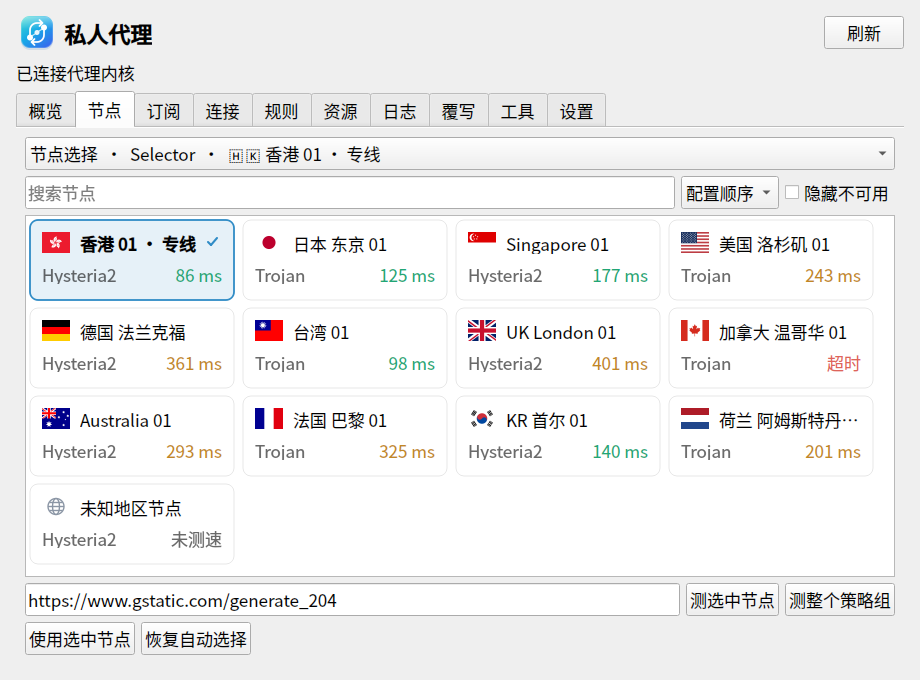

# dcc-proxy

UOS / Deepin 控制中心的原生 Qt 5 私人代理插件。插件包名和模块名均为 `dcc-proxy`，
后台进程名为 `dde-mihomo-daemon`。关闭控制中心后，后台内核继续提供代理。



## 构建和安装

使用已安装的 CMake、C++ 编译器、Qt 5.11+（Core、Widgets、Network、Qml、DBus、Test）和
`dde-control-center-dev`。YAML 解析器已随源码提供，不需要安装新依赖。

标准 Debian 打包（产物位于项目目录的上一级）：

```sh
cd /data/work/dcc-proxy
dpkg-buildpackage -us -uc -b
sudo dpkg -i ../dcc-proxy_0.1.1_$(dpkg --print-architecture).deb
```

也可继续使用 CPack 脚本（产物位于 `dist/`）：

```sh
./tools/build-deb.sh
sudo dpkg -i dist/dcc-proxy_0.1.1_$(dpkg --print-architecture).deb
```

两种方式共用 `tools/prepare-core.sh`，优先复用 `cores/` 中通过 SHA-256 校验的官方内核和源码归档；
缓存缺失时从官方 HTTPS 地址下载。断网构建前需准备相同缓存。
需要使用现有内核时，标准打包可设置 `DCC_PROXY_BUNDLE_CORE=0`；CPack 使用 `--without-core`。
默认最多使用 2 个编译任务，`DCC_PROXY_JOBS` 可调整。

脚本根据**构建机器**的架构自动选择官方 Mihomo v1.19.12 内核，只打包对应架构。
内核是官方预编译二进制；插件与后台管理程序在本机编译。下载缓存保存在 `cores/`，
构建和打包不自动执行 apt 安装。`--without-core` 可生成使用现有内核的包。
跨架构构建需要对应工具链和 Qt sysroot，也可直接在目标架构机器执行脚本。

控制中心接口优先使用 `/usr/include/dde-control-center`。没有开发头文件时可使用
仓库内接口快照，但最终发布必须使用目标系统的实际接口头，以避免 ABI 不兼容。

```sh
cmake -S . -B build -DCMAKE_BUILD_TYPE=Debug
cmake --build build --parallel 2
QT_QPA_PLATFORM=offscreen ctest --test-dir build --output-on-failure
./build/dcc-proxy-preview
```

## 使用

1. 重新打开控制中心，进入“私人代理”。
2. 在“订阅”顶部粘贴 URL，点击“URL 导入”，也可导入 Clash / Mihomo YAML 文件。
3. 在“设置”确认内核路径和控制器地址，保存并连接。
4. 首次导入后可直接点击“启动”；已有多个订阅时，选择订阅并点击“使用此配置”切换。
5. 在“节点”选择策略组，点击节点卡片主体直接使用该节点；点击延迟或失败状态只测速，不切换节点。
6. 启动成功后自动启用系统代理，浏览器可直接使用；停止时恢复原设置。TUN 仍按需开启，要求内核具有网络管理权限。

节点使用自适应卡片网格显示，每张卡片包含国旗、名称、协议和延迟。
国旗优先识别节点名中的地区旗帜，再识别中文地区名、常见英文地名及 ISO 地区代码。
图标使用内置 SVG，不依赖国旗字体；不能识别的节点使用地球图标，避免猜测位置。
节点名较长时省略显示，悬停可查看完整原始名称和内核信息；切换请求始终使用原始名称。
测速时对应卡片的勾选位置显示旋转进度环；整组测速逐节点回收结果，失败节点不会覆盖其他节点的成功结果。
测速口径按 Clash Party v2.0.3：默认启用 `unified-delay`，由内核计算连接建立后的第二次 HTTP 请求延迟；界面显示内核原始返回值。
默认超时 5000 ms、并发 50，均可调整并保存；测速地址优先使用手动设置，其次策略组 `url`，最后使用 `https://www.gstatic.com/generate_204`。
Provider 节点使用对应健康检查接口。定时刷新只更新变化的数据，保留卡片、选中项和滚动位置。
可调超时范围为 1–30000 ms，适配随包 Mihomo 的超时参数范围。

URL 下载参考 Clash Party 的 User-Agent，支持重定向、订阅流量信息和更新周期。
“订阅设置”可设置 User-Agent、Authorization、超时、更新周期和本地代理下载。
支持完整 YAML，以及原始或 Base64 编码的 Hysteria2、Trojan、VLESS、Shadowsocks、TUIC URI 列表。
其他分享格式建议由订阅服务输出 Clash / Mihomo YAML。

“设置 → 代理绕过”支持逐行填写域名、`*.example.com`、IPv4/IPv6 地址和 CIDR 网段。
默认绕过本机及常见局域网地址，点击“保存并应用绕过”立即更新已开启的系统代理或内置 PAC；
尚未启用代理时只保存列表。清空列表并保存可取消全部绕过。
关闭系统代理或停止后台时，会恢复启用前的代理模式、地址和绕过列表。
该列表作用于遵循系统代理设置的应用；TUN 和应用自行指定代理时，请使用 Mihomo 的 DIRECT 规则。

默认开启“节点域名使用系统 DNS”，在订阅启用了 DNS 且未指定 `proxy-server-nameserver` 时，
为节点服务器域名添加 `proxy-server-nameserver: [system]`，避免节点解析依赖尚未连通的代理。
订阅已有的节点专用 DNS 会保留；可在设置中关闭兼容选项，重启内核后生效。

默认控制器地址为 `http://127.0.0.1:19090`，首次运行生成随机 API 密钥。
连接已运行内核时填写其控制器地址和密钥。远端控制器要求 HTTPS。

后台通过当前用户专用 Unix socket 接受控制命令，插件退出不会结束后台。
“启动内核时自动启用系统代理”默认开启，后台确认控制器和混合端口可用后才启用代理。
“启动”“使用此配置”和重启内核都适用；首次导入尚无启用记录时，启动会使用首个已导入订阅。
启动前检查混合端口占用；与其他代理软件冲突时给出明确错误并保留现有内核。
首次启动可能需要下载规则数据库，允许最多 120 秒配置准备时间；启动验证失败时保留已有内核和代理设置。
只需要应用手动指定代理的用户，可在设置中取消该选项。
默认手动启动：点击“启动”或“使用此配置”才启动内核，打开控制中心本身不会启动内核。
勾选登录自启后由 systemd 用户服务在登录时启动；取消勾选不停止当前内核。

```sh
systemctl --user status dde-mihomo-daemon.service
/usr/lib/dcc-proxy/dde-mihomo-daemon --command status
/usr/lib/dcc-proxy/dde-mihomo-daemon --command stop
```

本地配置在 `~/.config/dcc-proxy/`，目录 0700、文件 0600。备份包含订阅和 API 密钥。
后台日志轮转为两个 2 MiB 文件，界面实时日志最多保留 2000 行。
测试可通过 `DCC_PROXY_DATA_DIR` 指定隔离数据目录，不影响已有订阅。

## 功能范围

详见 [Clash Party 功能对照](docs/feature-matrix.md)。本项目使用原生控件重写，
并非将 Electron 窗口嵌入控制中心。当前版本不能宣称与 Clash Party v2.0.3 全功能等价。
构建与真实内核验证见 [测试记录](docs/TESTING.md)。

## 来源与许可证

本项目沿用控制中心插件接口的 LGPL-3.0-or-later 许可，见 `LICENSE`。
`third_party/dcc-interface` 来自 dde-control-center 的接口快照。
`third_party/yaml-cpp` 来自 yaml-cpp 0.8.0（MIT），保留其许可证。
`third_party/flag-icons` 来自 [flag-icons](https://github.com/lipis/flag-icons)
的 4:3 SVG 资源（提交 `086f7e97d657358203916dbe84f61c2bccaa81eb`，MIT），保留其许可证。
功能参考 [Clash Party v2.0.3](https://github.com/mihomo-party-org/clash-party/tree/v2.0.3)，
API 依据 [Mihomo 官方文档](https://wiki.metacubex.one/api/)，未复制上游应用代码。
随包内核来自 [MetaCubeX/mihomo](https://github.com/MetaCubeX/mihomo/releases/tag/v1.19.12)，
其 GPL 许可证与对应源码归档安装在 `/usr/share/doc/dcc-proxy/`。
